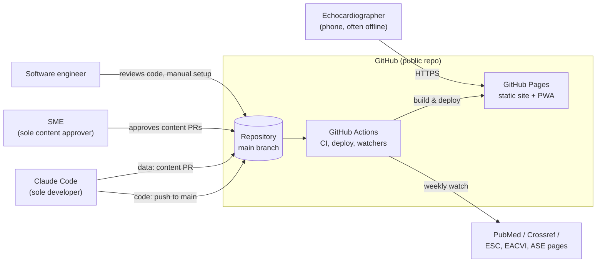
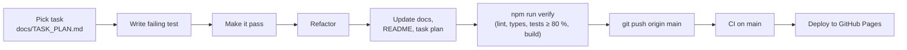
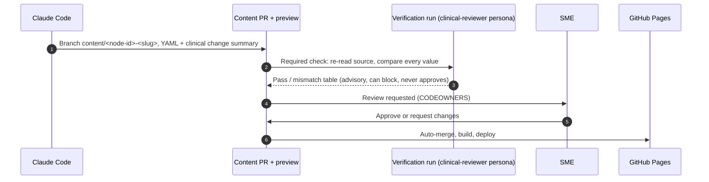
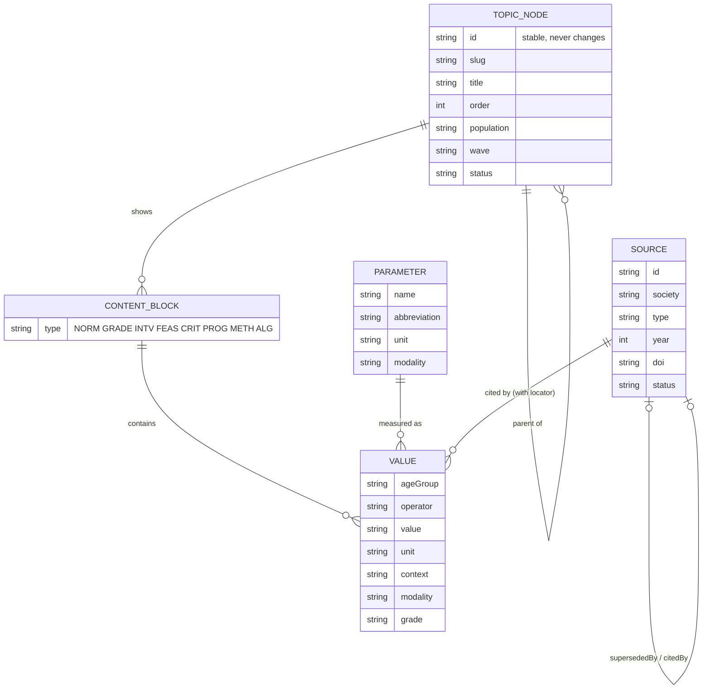

# Valvia: Architecture overview

> **Purpose:** how Valvia is built, deployed and updated, for maintenance and onboarding.
> **Audience:** software engineer, Claude Code sessions, new contributors.
> **Last updated:** 2026-11-02 | **Status:** target architecture; decisions marked *pending* await their ADR (`docs/adr/`).
> **Source:** backlog §2 ([`product/valvia-backlog.md`](product/valvia-backlog.md)).

## 1. Principles

- **Static first:** no servers or databases in v1; the output is plain static files (NFR-12).
- **Content as code:** clinical content is YAML in Git, validated by JSON Schema, reviewed in pull requests.
- **Every value has a source:** society, document, year, locator, DOI.
- **Lookup, not calculation:** no calculators or patient-specific scores in v1.
- **Near-zero cost:** GitHub (public repo, Pages, Actions) plus a domain.

## 2. System context

## 3. Repository layout

| Path | Contents | Change path |
|---|---|---|
| `/site` | Astro app: pages, components, styles ([ADR 0001](adr/0001-static-site-generator.md)) | Direct to `main` |
| `/content` | Topic tree, parameters, values, source registry, prosthetic catalogue (YAML) | **PR + SME approval** |
| `/schema` | JSON Schemas, generated TS types, plausibility rules | Direct to `main` |
| `/pipeline` | Source watchers, drafting and verification scripts | Direct to `main` |
| `/docs` | Documentation, ADRs, runbooks, task plan | Direct to `main` |

## 4. Change flows

### 4.1 Code change (direct to `main`)

### 4.2 Data update (pull request, SME approval)

The automated update pipeline (weekly watchers → issue → drafting → PR) is described in backlog §2 and EP-06.

## 5. Content model (outline)

To be detailed by the schema tasks (TS-02.x); field lists below are from the backlog.

## 6. Quality gates

| Gate | Where | Blocking |
|---|---|---|
| Lint, format, typecheck | local `npm run verify`, CI | yes |
| Unit/integration tests, coverage ≥ 80 % (100 % safety-critical) | local, CI | yes |
| Content schema + plausibility | CI | yes |
| E2E (Playwright, 360 px), axe | CI | yes |
| Lighthouse budgets (NFR-02) | CI | yes |
| Broken links | CI | yes |
| Verification run | content PRs | yes (SME override by comment) |
