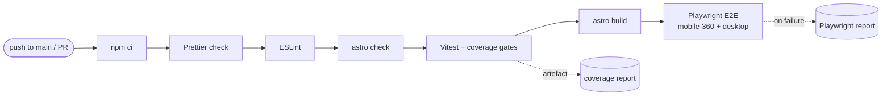

# CI/CD

> **Purpose:** what runs in GitHub Actions, when, and what to do when it fails.
> **Audience:** engineer, Claude Code sessions. **Last updated:** 2026-11-02

## Workflows

| Workflow | File | Trigger | Purpose | Backlog |
|---|---|---|---|---|
| CI | [`ci.yml`](../.github/workflows/ci.yml) | push to `main`, every PR, manual | Same gate as `npm run verify` | TS-01.3.1 |

Planned: deploy to GitHub Pages (TS-01.3.2), content PR previews (TS-01.3.3), content path guard, Lighthouse budgets (TS-05.2.1).

## CI pipeline

## Conventions

- Workflows use least-privilege `permissions` (default `contents: read`).
- GitHub-owned actions are pinned to a major tag (`actions/*@v7`); third-party actions are pinned to a full commit SHA with the version in a comment.
- Node version comes from `.nvmrc`; dependencies are installed with `npm ci` (lockfile is authoritative).
- Concurrency cancels superseded runs of the same ref.

## When CI is red on `main`

1. Reproduce locally with `npm run verify` (or the failing step's script).
2. Fix test-first; the fix is the next push and gets its own entry in the task plan push log.
3. Artefacts (`coverage`, `playwright-report`) are attached to the workflow run for diagnosis.
