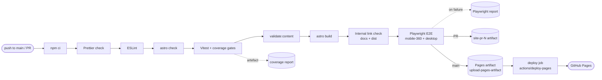

# CI/CD

> **Purpose:** what runs in GitHub Actions, when, and what to do when it fails.
> **Audience:** engineer, Claude Code sessions. **Last updated:** 2026-11-02

## Workflows

| Workflow | File | Trigger | Purpose | Backlog |
|---|---|---|---|---|
| CI | [`ci.yml`](../.github/workflows/ci.yml) job `verify` | push to `main`, every PR, manual | Same gate as `npm run verify` | TS-01.3.1 |
| Deploy | [`ci.yml`](../.github/workflows/ci.yml) job `deploy` | green `verify` on push to `main` | GitHub Actions Pages deployment of `dist/` ([ADR 0005](adr/0005-pages-actions-deploy-no-previews.md)) | TS-01.3.2 |

Pull requests: the `verify` job attaches the built site as artifact `site-pr-N` (14 days). No hosted previews.

Planned: content path guard, Lighthouse budgets (TS-05.2.1).

## CI pipeline

## Deployment

- Production URL: `VALVIA_SITE` + `VALVIA_BASE` (defaults `https://tudorgrigoriu90.github.io` + `/valvia/`).
  Override with repository **variables** of the same names (Settings → Secrets and variables → Actions → Variables), e.g. `VALVIA_BASE=/` after a custom domain is configured.
- The deploy job alone has `pages: write` and `id-token: write`; it runs only after `verify` succeeds on `main`, one at a time (`pages-deploy` concurrency group, never cancelled mid-deploy).
- No `gh-pages` branch exists; GitHub stores deployments itself. `404.html` is served for unknown URLs.
- Deploy time target: < 5 min from push (FT-01.3).

**One-time engineer setup (TS-08.1, `manual`, Pages enabled 2026-11-02):** *Settings → Pages → Build and deployment → Source* must be **GitHub Actions**, with *Enforce HTTPS* on.
If the deploy job fails with a Pages configuration error, check this setting first.

## Conventions

- Workflows use least-privilege `permissions` (default `contents: read`).
- GitHub-owned actions are pinned to a major tag (`actions/*@v7`); third-party actions are pinned to a full commit SHA with the version in a comment.
- Node version comes from `.nvmrc`; dependencies are installed with `npm ci` (lockfile is authoritative).
- Concurrency cancels superseded runs of the same ref.

## When CI is red on `main`

1. Reproduce locally with `npm run verify` (or the failing step's script).
2. Fix test-first; the fix is the next push and gets its own entry in the task plan push log.
3. Artefacts (`coverage`, `playwright-report`) are attached to the workflow run for diagnosis.
