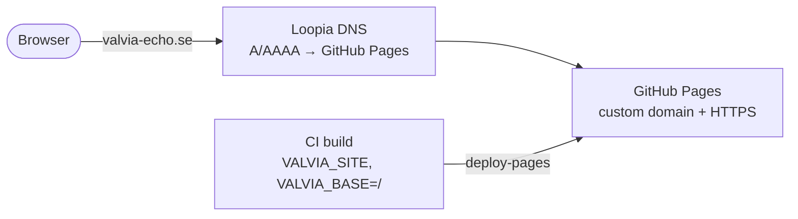

# CI/CD

> **Purpose:** what runs in GitHub Actions, when, and what to do when it fails.
> **Audience:** engineer, Claude Code sessions. **Last updated:** 2026-11-02

## Workflows

| Workflow | File | Trigger | Purpose | Backlog |
|---|---|---|---|---|
| CI | [`ci.yml`](../.github/workflows/ci.yml) job `verify` | push to `main`, every PR, manual | Same gate as `npm run verify` | TS-01.3.1 |
| Source watch | [`source-watch.yml`](../.github/workflows/source-watch.yml) | Mondays 05:17 UTC, manual | New society documents (PubMed) and errata of registered sources (Crossref) → one issue each; commits `pipeline/watch/state.json`; failures open a `watcher-failure` issue ([source watchers](source-watchers.md)) | TS-06.1.1 |
| Content audit | [`content-audit.yml`](../.github/workflows/content-audit.yml) | a merged PR to `main` that changes `content/**` | Adds the PR's merge time, approvers (latest review per reviewer), merger, sources and topics to [`CHANGELOG.md`](../CHANGELOG.md) and pushes it to `main` as `github-actions[bot]`; untrusted PR data passes through files, never the shell (`pipeline/audit`) | TS-06.4.2 |
| Deploy | [`ci.yml`](../.github/workflows/ci.yml) job `deploy` | green `verify` on push to `main` | GitHub Actions Pages deployment of `dist/` ([ADR 0005](adr/0005-pages-actions-deploy-no-previews.md)) | TS-01.3.2 |

Pull requests: the `verify` job attaches the built site as artifact `site-pr-N` (14 days). No hosted previews.

CI also runs **Lighthouse budgets** ([`lighthouserc.cjs`](../lighthouserc.cjs), TS-05.2.1) on the home page and two leaf pages at mobile settings: performance score ≥ 0.95, LCP ≤ 1.5 s, CLS ≤ 0.1 and JavaScript ≤ 50 KB are all blocking. Run locally with `CHROME_PATH=/opt/pw-browsers/chromium npm run lighthouse` after a build.

Planned: content path guard. When the `main` ruleset is set up (TS-01.3.5), allow `github-actions[bot]` to push (bypass list), or the content audit cannot record merged PRs.

## CI pipeline

## Deployment

- Production URL: `VALVIA_SITE` + `VALVIA_BASE` (defaults `https://tudorgrigoriu90.github.io` + `/valvia/`; `https://valvia-echo.se` + `/` once the custom domain below is set up).
  Override with repository **variables** of the same names (Settings → Secrets and variables → Actions → Variables), e.g. `VALVIA_BASE=/` after a custom domain is configured.
- **Analytics (TS-07.5.1):** off by default. To turn on cookieless counting after creating the account (TS-08.5, `manual`), set **one**
  repository variable: `VALVIA_GOATCOUNTER` (GoatCounter site code, e.g. `valvia`) or `VALVIA_CF_BEACON_TOKEN` (Cloudflare Web Analytics token).
  The build adds the beacon script and its origins to the CSP (`core/site/analytics.ts`), and the privacy page names the provider.
  A malformed value or both variables at once fail the build.
- **Report-a-problem e-mail fallback (TS-06.5.1):** optional repository variable `VALVIA_CONTACT_EMAIL` (a plain address the
  maintainers read). When set, every section's "Report a problem" link is followed by "or by e-mail" (`mailto:` with the
  page link prefilled); a malformed address fails the build. The GitHub issue form
  ([`.github/ISSUE_TEMPLATE/value-problem.yml`](../.github/ISSUE_TEMPLATE/value-problem.yml)) is always linked.
- The deploy job alone has `pages: write` and `id-token: write`; it runs only after `verify` succeeds on `main`, one at a time (`pages-deploy` concurrency group, never cancelled mid-deploy).
- The verify job checks out **full history** (`fetch-depth: 0`): the What's new page lists the latest content commits from `git log -- content/` (TS-06.4.1). A shallow clone builds, but the page then says no changes are recorded.
- No `gh-pages` branch exists; GitHub stores deployments itself. `404.html` is served for unknown URLs.
- Deploy time target: < 5 min from push (FT-01.3).

## Custom domain `valvia-echo.se` (TS-08.2, `manual`)

The domain is registered at Loopia (2026-11-09). Steps, in order:

1. **Verify the domain for the account:** GitHub → profile *Settings → Pages → Add a domain* → `valvia-echo.se`;
   GitHub shows a TXT record `_github-pages-challenge-tudorgrigoriu90` with a value.
2. **DNS at Loopia** (*Customer zone → Domain names → valvia-echo.se → DNS editor*): remove Loopia's parking records
   (A/AAAA on `@`, the `*` wildcard; keep MX if the domain has e-mail), then add:

   | Name | Type | Value |
   |---|---|---|
   | `@` | A | `185.199.108.153`, `185.199.109.153`, `185.199.110.153`, `185.199.111.153` |
   | `@` | AAAA | `2606:50c0:8000::153`, `2606:50c0:8001::153`, `2606:50c0:8002::153`, `2606:50c0:8003::153` |
   | `www` | CNAME | `tudorgrigoriu90.github.io.` |
   | `_github-pages-challenge-tudorgrigoriu90` | TXT | value from step 1 |

   Then click *Verify* on the GitHub page from step 1. (Records checked live on 2026-11-09.)
3. **Repository Pages settings** (*Settings → Pages*): *Custom domain* `valvia-echo.se` → Save; when the DNS check is green,
   tick *Enforce HTTPS* (the certificate can take up to about 24 h). No `CNAME` file is needed with the Actions deploy.
4. **Repository variables** (*Settings → Secrets and variables → Actions → Variables*): `VALVIA_SITE=https://valvia-echo.se`
   and `VALVIA_BASE=/`, then re-run the latest CI run on `main` (or push) so the site is rebuilt for the root path.
   Without this step the build still targets `/valvia/` and links break on the new domain.
5. **Check:** `https://valvia-echo.se/` loads with working links; `www.` and the old
   `tudorgrigoriu90.github.io/valvia/` redirect to it; the footer shows the latest content version.

**One-time engineer setup (TS-08.1, `manual`, Pages enabled 2026-11-02):** *Settings → Pages → Build and deployment → Source* must be **GitHub Actions**, with *Enforce HTTPS* on.
If the deploy job fails with a Pages configuration error, check this setting first.

## Conventions

- Workflows use least-privilege `permissions` (default `contents: read`).
- GitHub-owned actions are pinned to a major tag (`actions/*@v7`); third-party actions are pinned to a full commit SHA with the version in a comment.
- Node version comes from `.nvmrc`; dependencies are installed with `npm ci` (lockfile is authoritative).
- Concurrency cancels superseded runs of the same ref.

## When CI is red on `main`

For a wrong value or broken site already live, follow the [emergency rollback runbook](runbooks/emergency-rollback.md).

1. Reproduce locally with `npm run verify` (or the failing step's script).
2. Fix test-first; the fix is the next push and gets its own entry in the task plan push log.
3. Artefacts (`coverage`, `playwright-report`) are attached to the workflow run for diagnosis.

## Dependency updates (Renovate, TS-01.2.4)

[`renovate.json`](../renovate.json): weekly (Monday morning) update PRs; patch, minor, pin and digest updates
auto-merge once CI is green; majors are labelled `major` and need a planned task; `@playwright/test` is pinned to the
browser installed in the cloud environment and not updated automatically.

**One-time engineer setup (`manual`):** install the Renovate GitHub App on the repository and allow auto-merge
(Settings → General → Allow auto-merge).
