# Content guide

> **Purpose:** how to draft, cite and review clinical content so that any session can add a leaf from this guide alone.
> **Audience:** Claude Code sessions, engineer, SME. **Last updated:** 2026-11-13
> **Reference:** field-by-field schema in [`content-model.md`](content-model.md); rules in [`CLAUDE.md`](../CLAUDE.md) §12 and the [content policy](safety/content-policy.md).

## 1. Workflow

```mermaid
flowchart LR
    pick["Pick a leaf<br/>(docs/TASK_PLAN.md, FT-03.x)"] --> doc["Get the source document<br/>(ASE PDF from asecho.org,<br/>ESC/EACVI PDF supplied by a person)"]
    doc --> read["Read the table in the PDF<br/>(render the page if the table is an image)"]
    read --> reg["Register the source<br/>(content/sources, metadata from PubMed)"]
    reg --> params["Add missing parameters<br/>(content/parameters)"]
    params --> blocks["Add blocks + values to the leaf<br/>(content/topics/&lt;id&gt;.yaml)"]
    blocks --> check["npm run validate:content<br/>npm run verify"]
    check --> route{"Initial seed?<br/>(PO-3)"}
    route -- yes --> main(["push to main, status: draft"])
    route -- no --> pr(["content PR to main,<br/>SME approves"])
```



- **Initial seed (decision PO-3):** content is pushed directly to `main` as `status: draft`; the site labels it
  "Not yet clinically reviewed". After the seed, every change goes through a content PR ([template](../.github/pull_request_template.md)).
- **One subcategory per push or PR.**

## 2. Sources

- Only ESC (incl. EACVI) and ASE documents; registry rules reject others (`npm run validate:content`).
- Register each document once in `content/sources/<id>.yaml` with metadata from its **PubMed record** (title, journal,
  DOI, PMID in `notes`). Never type metadata from memory.
- If the PDF you read is a different publication of the same document (JASE vs EHJ-CVI), register the one whose
  **page numbers** you cite and mention the twin in `notes`.
- If the publisher notes that part of a document is replaced (e.g. ASE's note on the 2009 stenosis recommendations
  for mitral stenosis), do not enter that part.
- ESC/EACVI full texts on academic.oup.com cannot be fetched automatically; a person downloads and supplies them.

## 3. Reading tables reliably

| Pitfall | What to do |
|---|---|
| Table is an image (only the caption is extracted) | Render the page (`pdftoppm -f N -l N -r 110 -png`) and read the image |
| Minus signs or ≥ / ≤ lost in text extraction (`$` = ≥, `#` = ≤ in some PDFs) | Check the rendered page before entering signed values such as GLS (−18%) |
| Contiguous grades with mixed bounds (`≥ 5.4 to ≤ 5.8`, `> 5.8 to ≤ 6.3`) | Use `minExclusive` / `maxExclusive` on ranges |
| Values that only make sense with a qualifier not in the schema (e.g. BMI) | Make one block per stratum, named in the block title |
| Same parameter, different methods (TDI vs PW MPI, 3- vs 6-segment strain) | Use separate parameters, or caveats when only one value per cell |
| Strain published as magnitudes | Store as published and add a caveat "Absolute value (magnitude)" |
| Labels that look wrong in the source (e.g. RWT "in cm") | Store correctly typed and add a caveat explaining the source label |
| Ambiguous row label | Do not enter the row; say so in the commit message |

## 4. Modelling a leaf

```yaml
blocks:
  - id: quantitative-grading          # anchor, unique in the topic
    type: grading-table               # grading-table | normal-range-table | threshold-list | criteria-checklist | note | algorithm-reference
    tag: GRADE                        # must fit the type (see content-model.md)
    title: Quantitative grading of chronic MR
    grades: ["Mild", "Moderate", "Severe"]   # least to most severe, as printed
    values:
      - parameter: eroa
        context: grading
        grade: Severe
        operator: ">="
        value: 0.40                   # exactly as published (0.40 stays 0.40)
        unit: cm²                     # as published; also displayed as published (PO-4)
        modality: Echo                # Echo | CT | CMR
        population: { ageGroup: adult }
        caveats: ["May be lower in secondary MR with an elliptical regurgitant orifice."]
        citation: { source: ase-2017-native-regurgitation, locator: { table: "8", page: "332" } }
```

- **Locators** are strings (`"8"`, `"6.2.1"`, `"e45"`), so `1.10` is never read as `1.1`.
- **Population:** always `ageGroup`; add `sex`, `ageBand` (with the printed `label`), `bsaBand`, `rhythm` when the source does.
- **Notes** are written in your own words, short, and cite where the advice is; never copy paragraphs.
- **Algorithms** are linked (`algorithm-reference`), never redrawn.
- **Scores** (e.g. Wilkins) are shown as their definition; Valvia never computes a patient's score.

## 5. Checks before pushing

- `npm run validate:content`: schema, references, allowlist, units, plausibility (monotonic grades, ranges, signs).
  Discrepancies between current sources are listed for information; they are expected and shown side by side.
- `npm run verify`: the full gate, including E2E on the built site.
- Commit message: what was transcribed, from which table and page, anything deliberately not entered and why.
