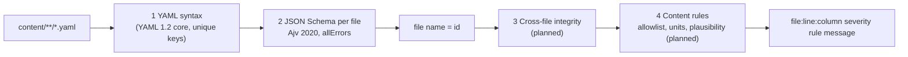

# Content model reference

> **Purpose:** field-by-field reference of the content schemas and how content is validated.
> **Audience:** engineer, Claude Code sessions drafting content, SME (for review context).
> **Last updated:** 2026-11-02 | **Source of truth:** [`/schema`](../schema/README.md) (this page explains it)

## Validation pipeline



Every problem names the file, the 1-based line and column of the offending YAML node, and a readable message, e.g.

```
content/topics/primary-mr-grading.yaml:8:13 error schema population must be one of: adult, paediatric, both (got 'neonates')
```

All problems are reported in one run, not only the first. Code: [`core/content/`](../core/content).

TypeScript types are generated from the schemas into [`schema/generated/`](../schema/generated) (`npm run gen:types`); see [`schema/README.md`](../schema/README.md) for the change procedure.

## Shared definitions (`common.schema.json`)

| Definition | Rule |
|---|---|
| `id` | lowercase kebab-case (`^[a-z0-9]+(-[a-z0-9]+)*$`), ≤ 80 chars; stable, never changed or reused |
| `slug` | same format as `id`; may change (old values go to `formerSlugs`) |
| `text` | non-blank single line, ≤ 300 chars |
| `longText` | non-blank, may span lines, ≤ 4000 chars |
| `population` | `adult` · `paediatric` · `both` |
| `wave` | `W1` · `W2` |

## Topic node (`topic.schema.json`, TS-02.1.1)

One file per node: `content/topics/<id>.yaml`. The tree is built from `parent` links.

| Field | Required | Type | Meaning |
|---|---|---|---|
| `id` | yes | `id` | Stable identifier; must equal the file name |
| `ref` | no | dotted number | Taxonomy number for humans (`3.2.1.2`); may change, never in URLs |
| `slug` | yes | `slug` | URL segment |
| `formerSlugs` | no | `slug[]` | Previous slugs → static redirect pages (TS-02.1.3) |
| `title` | yes | `text` | Display title |
| `parent` | yes | `id` or `null` | Parent node; `null` for a root category |
| `order` | yes | integer ≥ 0 | Position among siblings |
| `synonyms` | no | `text[]` | Alternative names/abbreviations indexed by search |
| `population` | yes | `population` | Adult, paediatric or both (drives the adult/paediatric switch) |
| `wave` | yes | `wave` | Delivery wave (sequencing only) |
| `status` | yes | `draft` · `in-review` · `published` | Editorial status (content status page) |
| `seeAlso` | no | `id[]` | Cross-links (→ in the taxonomy) |

Example:

```yaml
id: primary-mr-grading
ref: 3.2.1.2
slug: severity-grading
title: Primary MR severity grading
parent: primary-mr
order: 1
synonyms: [primary mitral regurgitation, degenerative MR]
population: adult
wave: W1
status: draft
```
