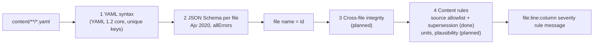
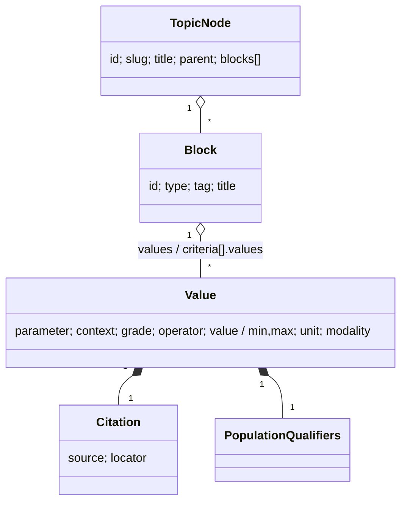

# Content model reference

> **Purpose:** field-by-field reference of the content schemas and how content is validated.
> **Audience:** engineer, Claude Code sessions drafting content, SME (for review context).
> **Last updated:** 2026-11-02 | **Source of truth:** [`/schema`](../schema/README.md) (this page explains it)

## Validation pipeline



Every problem names the file, the 1-based line and column of the offending YAML node, and a readable message, e.g.

```
content/topics/primary-mr-grading.yaml:8:13 error schema population must be one of: adult, paediatric, both (got 'neonates')
```

All problems are reported in one run, not only the first. Code: [`core/content/`](../core/content).

TypeScript types are generated from the schemas into [`schema/generated/`](../schema/generated) (`npm run gen:types`); see [`schema/README.md`](../schema/README.md) for the change procedure.

## Shared definitions (`common.schema.json`)

| Definition | Rule |
|---|---|
| `id` | lowercase kebab-case (`^[a-z0-9]+(-[a-z0-9]+)*$`), ≤ 80 chars; stable, never changed or reused |
| `slug` | same format as `id`; may change (old values go to `formerSlugs`) |
| `text` | non-blank single line, ≤ 300 chars |
| `longText` | non-blank, may span lines, ≤ 4000 chars |
| `population` | `adult` · `paediatric` · `both` |
| `wave` | `W1` · `W2` |
| `locatorText` | non-blank single line, ≤ 40 chars; always a string so `1.10` is never read as `1.1` |
| `modality` | `Echo` · `CT` · `CMR` (SME decision 4) |
| `quantity` | physical quantity (`length`, `area`, `velocity-blood`, `velocity-tissue`, `indexed-volume`, `ratio`, …) |
| `unit` | units as published: `1` (dimensionless), `%`, `mm`, `cm`, `mm²`, `cm²`, `mL`, `mL/m²`, `g/m²`, `m/s`, `cm/s`, `mmHg`, `ms`, … (full list in the schema) |
| `citation` | `source` (registered source id) + `locator` with at least one of `table`, `figure`, `section`, `page` (TS-02.3.2) |

| `populationQualifiers` | who a value applies to (TS-02.2.5), see below |

### Population qualifiers (every value)

| Field | Required | Meaning |
|---|---|---|
| `ageGroup` | yes | `adult` or `paediatric` (never both): an adult value is never shown for a child by default |
| `sex` | no | `male` / `female`; omit when the value applies to both |
| `ageBand` | no | `{ min, max, unit: days \| months \| years, label }`, at least one bound; `min` inclusive, `max` exclusive |
| `bsaBand` | no | `{ min, max, label }` in m² (DuBois), at least one bound |
| `rhythm` | no | `sinus` / `atrial-fibrillation`; omit when rhythm-independent |
| `zScoreReference` | no | id of the cited z-score dataset a z-score value refers to (shown as published, never computed) |

```yaml
population:
  ageGroup: adult
  sex: female
  ageBand: { min: 40, max: 60, unit: years, label: 40–59 years }
```

### Value (`$defs/value`, TS-02.2.2)

One published number or range. Values live inside content blocks of leaf topics (TS-02.2.3).

| Field | Required | Meaning |
|---|---|---|
| `parameter` | yes | parameter id |
| `context` | yes | `grading` · `normal-range` · `intervention-threshold` · `feasibility` · `diagnostic-criterion` · `prognostic-marker` |
| `grade` | for grading / feasibility | grade or category as printed (`severe`, `favourable`, …) |
| `operator` | yes | `<` · `<=` · `>` · `>=` · `=` · `range` |
| `value` | unless `range` | the published number (not allowed with `range`) |
| `min`, `max` | with `range` | the published range ends (not allowed otherwise) |
| `unit` | yes | unit as published |
| `modality` | yes | `Echo` · `CT` · `CMR`; must be one of the parameter's `modalities` (TS-02.2.6, `core/values/modality.ts`) |
| `population` | yes | population qualifiers |
| `caveats` | no | footnotes printed with the value |
| `citation` | yes | source + locator |

Numbers are YAML numbers; the loader keeps their exact source text (e.g. `0.40`) for display, so precision is never lost.

```yaml
parameter: eroa
context: grading
grade: severe
operator: ">="
value: 0.40
unit: cm²
modality: Echo
population: { ageGroup: adult }
citation: { source: esc-eacts-2025-vhd, locator: { table: "8" } }
```

Citation example (used by every value):

```yaml
citation:
  source: esc-eacts-2025-vhd
  locator:
    table: "8"
    section: "6.2.1"
```

Shared definitions can be validated on their own with `validateDefinition('citation', yaml)` (`core/content/validate-file.ts`).

## Topic node (`topic.schema.json`, TS-02.1.1)

One file per node: `content/topics/<id>.yaml`. The tree is built from `parent` links.

| Field | Required | Type | Meaning |
|---|---|---|---|
| `id` | yes | `id` | Stable identifier; must equal the file name |
| `ref` | no | dotted number | Taxonomy number for humans (`3.2.1.2`); may change, never in URLs |
| `slug` | yes | `slug` | URL segment |
| `formerSlugs` | no | `slug[]` | Previous slugs → static redirect pages (TS-02.1.3) |
| `title` | yes | `text` | Display title |
| `parent` | yes | `id` or `null` | Parent node; `null` for a root category |
| `order` | yes | integer ≥ 0 | Position among siblings |
| `synonyms` | no | `text[]` | Alternative names/abbreviations indexed by search |
| `population` | yes | `population` | Adult, paediatric or both (drives the adult/paediatric switch) |
| `wave` | yes | `wave` | Delivery wave (sequencing only) |
| `status` | yes | `draft` · `in-review` · `published` | Editorial status (content status page) |
| `seeAlso` | no | `id[]` | Cross-links (→ in the taxonomy) |
| `blocks` | no | block[] | Content blocks of a leaf (see below) |

Example:

```yaml
id: primary-mr-grading
ref: 3.2.1.2
slug: severity-grading
title: Primary MR severity grading
parent: primary-mr
order: 1
synonyms: [primary mitral regurgitation, degenerative MR]
population: adult
wave: W1
status: draft
```

## Content blocks (`$defs/block`, TS-02.2.3)

Leaf topics hold `blocks:` in display order. The `type` selects the block shape (Ajv discriminator), so errors only come from the selected shape.

| `type` | Allowed `tag` | Specific fields | Renders as |
|---|---|---|---|
| `grading-table` | GRADE | `grades` (≥ 2, least → most severe), `values` (≥ 1) | Grading table, one column per grade |
| `normal-range-table` | NORM | `values` | Normal-range table (sex/age/BSA columns from population qualifiers) |
| `threshold-list` | INTV · PROG · CRIT | `values` | List of thresholds |
| `criteria-checklist` | FEAS · CRIT | `criteria[]`: `text`, optional `category` (favourable · challenging · unsuitable), optional `values`, `citation` | Checklist |
| `note` | METH · CRIT | `text`, optional `citation` | Paragraph |
| `algorithm-reference` | ALG | `title`, `citation`, optional https `url` | Link to the source algorithm (never redrawn) |

Every block has `id` (anchor, unique within the topic), `type`, `tag` and an optional `title`.



```yaml
blocks:
  - id: severity
    type: grading-table
    tag: GRADE
    title: Severity of primary MR
    grades: [mild, moderate, severe]
    values:
      - parameter: eroa
        context: grading
        grade: severe
        operator: ">="
        value: 0.40
        unit: cm²
        modality: Echo
        population: { ageGroup: adult }
        citation: { source: esc-eacts-2025-vhd, locator: { table: "8" } }
```

## Parameter (`parameter.schema.json`, TS-02.2.1)

One file per parameter: `content/parameters/<id>.yaml`. Values reference a parameter by id.

| Field | Required | Type | Meaning |
|---|---|---|---|
| `id` | yes | `id` | e.g. `eroa` |
| `name` | yes | `text` | Full name |
| `abbreviation` | no | `text` | Shown in tables, indexed by search |
| `quantity` | yes | `quantity` | Decides the display unit and the units values may use |
| `unit` | yes | `unit` | Display (house) unit, NFR-15: lengths mm, areas cm², blood velocities m/s, tissue Doppler cm/s |
| `modalities` | yes | `modality[]` (≥ 1) | Modalities in which it is measured |
| `synonyms` | no | `text[]` | Search synonyms |
| `method` | no | `longText` | View / method note and pitfalls |

```yaml
id: eroa
name: Effective regurgitant orifice area
abbreviation: EROA
quantity: area
unit: cm²
modalities: [Echo]
synonyms: [ERO]
method: PISA method, apical 4-chamber zoom; single frame at peak regurgitant velocity.
```

Unit/quantity consistency (e.g. `quantity: area` with `unit: cm²`) is enforced by the unit layer: see [`units.md`](units.md).

## Source document (`source.schema.json`, TS-02.3.1)

One file per source: `content/sources/<id>.yaml`. Every value cites a source id plus a locator.

| Field | Required | Type | Meaning |
|---|---|---|---|
| `id` | yes | `id` | e.g. `esc-eacts-2025-vhd` |
| `title` | yes | `text` | Full title |
| `shortTitle` | no | `text` | Label for source chips |
| `issuers` | yes | acronym[] (≥ 1) | Issuing societies, e.g. `[ESC, EACTS]` |
| `type` | yes | enum | `guideline` · `recommendation` · `consensus-statement` · `position-statement` · `focused-update` · `standardized-definitions` · `z-score-dataset` |
| `year` | yes | integer 1990–2100 | Publication year |
| `journal` | no | `text` | Journal |
| `doi` | no | DOI | Without `https://doi.org/` |
| `url` | no | https URL | Landing page |
| `status` | yes | `current` · `superseded` · `withdrawn` | Only `current` sources supply current recommendations |
| `supersededBy` | when superseded | `id` | Successor document |
| `citedBy` | for z-score datasets | `id[]` | Registered ESC/ASE documents citing the dataset |
| `notes` | no | `longText` | Maintainer notes |

### Registry rules (`core/sources/registry-rules.ts`, 100 % coverage)


Also enforced: unique ids; `supersededBy` only with status `superseded`, must exist, must not be the source itself,
must not be older, and supersession chains must not form cycles; `citedBy` only on z-score datasets.

Example:

```yaml
id: esc-eacts-2025-vhd
title: ESC/EACTS Guidelines for the management of valvular heart disease
shortTitle: ESC/EACTS VHD 2025
issuers: [ESC, EACTS]
type: guideline
year: 2025
journal: European Heart Journal
status: current
```
