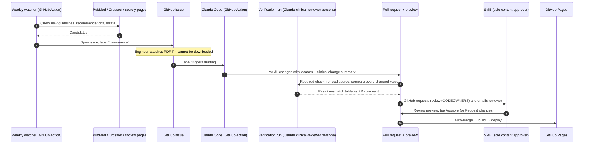

# Valvia: Product Backlog (MVP + v2)

> Web app for quick lookup of echocardiography reference and cut-off values (adult and paediatric) from EACVI, ESC and ASE documents.
> **Status:** Draft v0.3 | **Date:** 2 Nov 2026 | **Owner:** Product Owner
> **Companion document:** `valvia-taxonomy.md` (category tree, SME decisions, source registry, follow-up questions)
>
> Keys (EP / FT / TS) are placeholders. Jira assigns real keys on import. Hierarchy: **Epic → Feature → Task**.
>
> **Changes in v0.3:** app named **Valvia**; SME decisions applied (paediatric scope, ESC/EACVI/ASE sources only, previous recommendations kept as history, CT/CMR values included, algorithms linked only, prosthetic model/size tables, English only, units mm / cm² / m/s with DuBois BSA, all content P1, SME as the only content approver, with a Claude clinical-reviewer persona built by the engineer as second reviewer; paediatric z-score datasets cited by ESC/ASE documents included).
> **Changes in v0.2:** GitHub Pages (public repo); SME approval as GitHub PR review; Claude Code as sole developer; engineer manual tasks listed.

---

## 0. Team & ways of working

| Role | Who | Responsibilities |
|---|---|---|
| Developer | **Claude Code** (sole developer) | Writes all code, tests, content drafts and documentation; opens every change as a PR |
| Software engineer | 1 person | Reviews and approves **code** PRs; performs manual setup and maintenance (labelled `manual`); supplies source PDFs that cannot be downloaded automatically; builds and maintains the Claude clinical-reviewer persona (TS-06.3.6); **never approves content PRs** |
| Subject matter expert (SME) | 1 clinician | Owns the clinical content; **sole approver** of content PRs |

**Working rules**

1. **Every change is a PR.** No direct pushes to `main`.
2. **One task = one PR.** Tasks are sized so Claude Code can complete them in one session, with testable acceptance criteria.
3. **CODEOWNERS split the reviews.** `/content/**` requires the SME; everything else requires the engineer.
4. **CI is the safety net.** Strict automated checks (schema, tests, unit conversions, performance budgets, accessibility, links) replace peer review between developers.
5. **`CLAUDE.md` is the source of conventions.** Architecture, coding rules, content-modelling rules, units and the Definition of Done live there.
6. **Human review time is the bottleneck, not coding.** Story points are relative size for sequencing; plan releases around SME and engineer review capacity.

---

## 1. Product summary

**Problem.** Echocardiographers must remember hundreds of reference and cut-off values spread across many ESC, EACVI and ASE documents, which are updated every few years and sometimes disagree with each other.

**Users.** Echocardiographers, adult and paediatric cardiologists, cardiology fellows, sonographers. Often on a phone, in an echo lab, sometimes with poor signal.

**Core job to be done.** "Find the cut-off I need, see who endorses it, in under 10 seconds and 3 taps."

**Guiding principles**

1. **Every value has a source.** Society, document, year, table/section, DOI. No orphan numbers.
2. **Disagreements and history are explicit.** When ESC/EACVI and ASE differ, both values are shown side by side. Values from superseded documents stay visible as "Previous recommendations".
3. **Nothing reaches production without approval of the content PR.** Automation detects and drafts; the Claude reviewer persona checks; the SME approves; automation merges and publishes.
4. **Static first.** No servers or databases in v1. Content lives as versioned files in a public Git repo.
5. **Lookup, not calculation (v1).** Displaying published values (including z-score references) keeps the product out of medical-device territory; calculators, including patient z-score computation, are out of scope (see EP-07).
6. **Only ESC (incl. EACVI) and ASE sources.** Other bodies and manufacturer data are excluded, except paediatric z-score datasets that an ESC or ASE document cites. Algorithms are linked, not redrawn.

**Success metrics (MVP)**

| Metric | Target |
|---|---|
| Time to a value from home screen | ≤ 10 s, ≤ 3 taps (or 1 search) |
| Values with complete citation | 100 % |
| Values published without content approval | 0 |
| Content PR approval turnaround (median) | ≤ 7 days |
| Running cost | ≤ €15 / year (domain) + Claude usage for drafting |
| Lighthouse mobile performance score | ≥ 95 |

---

## 2. Architecture (near-zero cost)

| Concern | Choice | Why | Cost |
|---|---|---|---|
| Repository | **Public** GitHub repo | Free GitHub Pages, free branch rulesets, unlimited Actions minutes, free secret scanning; transparency suits a medical reference | €0 |
| Content storage | YAML files in Git ("content as code"), validated by JSON Schema | Versioned, diffable, reviewable; full audit trail for free | €0 |
| Site | Static site generator (Astro recommended; ADR in FT-01.1) | Ships ~0 KB JS by default, fast on phones | €0 |
| Hosting | **GitHub Pages**, deployed by GitHub Actions | One platform for code, review, CI and hosting | €0 |
| PR previews | `pr-preview-action` publishes each PR to `/pr-preview/pr-N/` and posts the link; removed when the PR closes | GitHub Pages has no native previews | €0 |
| Content approval | GitHub PR review: CODEOWNERS + branch ruleset + auto-merge | No custom approval code; GitHub emails reviewers automatically | €0 |
| Content drafting | Claude Code GitHub Action, triggered by labelled issues | Claude Code is the developer, also for content updates | API usage (small; capped) |
| Search | Pagefind (static, client-side index) | No search server | €0 |
| Offline | PWA service worker (Workbox) | Works in labs with no signal | €0 |
| Analytics | Cloudflare Web Analytics or GoatCounter (cookieless beacon) | No consent banner needed | €0 |
| Dependency upkeep | Renovate with auto-merge for patch/minor on green CI | Maintenance close to zero | €0 |
| Domain | `valvia.app` or similar (check availability and trademarks) | | ~€10–15 / year |
| v2 auth + user data | Spike: Supabase vs Firebase (client-side SDK, works on a static site) | Free tiers with Google/Facebook/Microsoft providers | €0 at expected scale |

**GitHub Pages limitations, accepted:**
- No custom HTTP headers → CSP via `<meta>` tag; HTTPS enforced by GitHub.
- No server-side redirects → static redirect pages generated at build for renamed slugs.
- Soft limits (1 GB site, ~100 GB/month bandwidth) are far above expected use.

### Update flow with approval via pull request

**Hard rules**
- `main` accepts changes only via PR with all checks green.
- Any change under `/content/**` requires approval from the SME, the only content CODEOWNER.
- The verification run (Claude clinical-reviewer persona) is a required check on content PRs; a mismatch blocks merge until fixed or explicitly overridden by the SME in a PR comment. The persona is advisory: it can block, never approve.
- Emergency rollback: if a published value is found to be wrong, the engineer may revert the content PR using the ruleset's admin bypass. A revert only removes content, never adds or changes values; it is logged and the SME is notified. The corrected value then goes through the normal flow.
- Automation never merges content without SME approval.

---

## 3. Non-functional requirements

| ID | Requirement | Measure / acceptance |
|---|---|---|
| NFR-01 | Mobile rendering | Fully usable from 360 px width; tables readable without pinch-zoom; touch targets ≥ 44 px |
| NFR-02 | Performance | LCP ≤ 1.5 s on mid-range Android over 4G; ≤ 50 KB gzipped JS per topic page; Lighthouse perf ≥ 95 (blocking in CI) |
| NFR-03 | Offline | All published content and search usable offline after first visit; user prompted when new content is available |
| NFR-04 | Running cost | No servers or paid databases in v1; infra cost = domain only; Claude usage capped by a monthly spending limit |
| NFR-05 | Maintainability | Content changes need no code changes; readable schema errors; dependency updates automated; conventions in `CLAUDE.md`; one-command local setup |
| NFR-06 | Content governance | 100 % of content changes approved through PR review; approver, date and source visible in Git history |
| NFR-07 | Traceability | Each value links to society, document, year, table/section/page, DOI |
| NFR-08 | Automated updates with approval | Weekly detection of new/updated source documents; drafted PR within 1 day of detection (unless a PDF must be supplied manually); publish only after approval |
| NFR-09 | Accessibility | WCAG 2.2 AA; society and modality badges never rely on colour alone |
| NFR-10 | Security | CSP via meta tag; branch rulesets; least-privilege tokens for Actions; secret scanning and push protection enabled; no PII in v1 |
| NFR-11 | Privacy | Cookieless analytics in v1; GDPR-compliant account handling in v2 |
| NFR-12 | Portability | Output is plain static files; hosting can be moved in under a day |
| NFR-13 | Browser support | Last 2 versions of iOS Safari, Chrome Android, desktop Chrome/Edge/Firefox/Safari |
| NFR-14 | Dark mode | Supported (echo labs are dimly lit) |
| NFR-15 | Units | Display lengths in mm, areas in cm², blood-flow velocities in m/s, tissue Doppler velocities in cm/s; other units per taxonomy 14.2; BSA by DuBois. Values stored as published; every conversion unit-tested; original value and unit shown on tap |
| NFR-16 | Language | English only |

---

## 4. Epic overview

| Key | Epic | Release | SP |
|---|---|---|---|
| EP-00 | Discovery & SME validation | MVP | 8 |
| EP-01 | Foundation, CI/CD & Claude Code workflow | MVP | 20 |
| EP-02 | Content model & source registry | MVP | 37 |
| EP-03 | Clinical content production | MVP | 115 |
| EP-04 | Navigation & lookup UX | MVP | 50 |
| EP-05 | Mobile, performance & offline | MVP | 13 |
| EP-06 | Guideline update pipeline with PR-based approval | MVP (watchers in R1.1) | 42 |
| EP-07 | Quality, compliance & legal | MVP | 19 |
| EP-08 | Engineer setup, release & operations | MVP | 12 |
| | **MVP total** | | **316** |
| EP-09 | User accounts (Google, Microsoft, Facebook) | v2 | 17 |
| EP-10 | Favourites | v2 | 9 |
| EP-11 | Admin content management | v2 | 17 |
| EP-12 | Notifications for favourites | v2 | 13 |
| | **v2 total** | | **56** |

### Release plan

All content is P1 (SME decision). It is delivered in two waves so a usable beta ships early.

| Release | Content | Exit criterion |
|---|---|---|
| **R0: Walking skeleton** | EP-08 manual setup, EP-01, core of EP-02, one leaf end to end (e.g. *Primary MR → severity grading*) | SME approves a real content PR from the phone and sees it live on GitHub Pages |
| **R1: MVP beta, wave 1** | Content W1 (chamber, diastolic, VHD, prosthetic grading, PH, cardiomyopathies & HF, pericardial, reference); EP-04, EP-05, EP-06 drafting + approval, EP-07 | SME + 3 to 5 colleagues use it for 2 weeks; zero critical content defects |
| **R1.1: Automated watchers** | FT-06.1 | First real update detected, drafted, approved and published with no manual step except approval |
| **R1.2: MVP complete, wave 2** | Content W2 (prosthetic model/size tables, congenital, paediatric, stress echo, aorta, cardio-oncology, masses, special populations) | Full taxonomy published; content audit passed |
| **R2: v2** | EP-09 to EP-12 | Accounts, favourites, admin editing, notifications |

---

## 5. Backlog detail

### EP-00: Discovery & SME validation (MVP)

| Key | Summary | SP | Labels |
|---|---|---|---|
| TS-00.1 | Taxonomy validation with SME | 2 | discovery, sme |
| TS-00.2 | Record SME decisions in `/docs/decisions` (✅ answers received 2 Nov 2026; F1 answered: z-score datasets cited by ESC/ASE included; follow-ups F2–F5 open) | 1 | discovery, sme |
| TS-00.3 | Competitor scan (ESC Pocket Guidelines app, ASE app, others); define differentiation | 2 | discovery |
| TS-00.4 | Confirm delivery waves (all content P1) and success metrics | 1 | discovery |
| TS-00.5 | Agree emergency-rollback rule with SME (engineer may revert, never add or change values) | 1 | governance |
| TS-00.6 | Usability test of clickable prototype with 3 echocardiographers (incl. 1 paediatric) | 1 | discovery, ux |

---

### EP-01: Foundation, CI/CD & Claude Code workflow (MVP)

#### FT-01.1: Architecture decisions
**Acceptance criteria:** ADRs merged in `/docs/adr`; each states cost and exit strategy; `CLAUDE.md` links to them.

| Key | Summary | SP | Labels |
|---|---|---|---|
| TS-01.1.1 | ADR: static site generator (Astro vs Eleventy) | 2 | adr |
| TS-01.1.2 | ADR: GitHub Pages hosting, PR previews, meta-CSP and static redirects | 1 | adr |
| TS-01.1.3 | ADR: content as code (YAML in Git) | 1 | adr |
| TS-01.1.4 | ADR: client-side search (Pagefind) | 1 | adr |

#### FT-01.2: Repository & Claude Code setup
**Acceptance criteria:** `npm i && npm run dev` works on a clean machine; `CLAUDE.md` covers architecture, conventions, content rules (sources, units, DuBois, history, modality), test expectations and Definition of Done; PR templates exist for code and content.

| Key | Summary | SP | Labels |
|---|---|---|---|
| TS-01.2.1 | Repo structure: `/site`, `/content`, `/schema`, `/pipeline`, `/docs` | 2 | setup |
| TS-01.2.2 | `CLAUDE.md`: architecture, coding conventions, content-modelling rules, units, DoD | 2 | setup, claude |
| TS-01.2.3 | TypeScript strict, ESLint, Prettier | 1 | setup |
| TS-01.2.4 | Renovate config with auto-merge for patch/minor on green CI | 1 | maintenance |
| TS-01.2.5 | PR templates: code PR; content PR (clinical change summary table, sources, preview link, reviewer checklist) | 1 | setup, governance |

#### FT-01.3: CI/CD on GitHub
**Acceptance criteria:** every PR gets a preview link posted as a comment; preview removed on close; merge to `main` deploys in < 5 min; CODEOWNERS and rulesets enforce the review split.

| Key | Summary | SP | Labels |
|---|---|---|---|
| TS-01.3.1 | CI: build, schema validation, unit tests, Lighthouse CI, axe, broken-link check | 3 | ci |
| TS-01.3.2 | Deploy to GitHub Pages via Actions on merge to `main` | 1 | cd |
| TS-01.3.3 | PR previews with `pr-preview-action` (deploy, comment link, clean up on close); exclude previews from search engines | 2 | cd |
| TS-01.3.4 | CODEOWNERS: `/content/**` → SME only; everything else → engineer | 1 | governance |
| TS-01.3.5 | Branch ruleset on `main`: PR required, required checks, CODEOWNER review, auto-merge allowed, delete branch on merge; admin bypass reserved for emergency reverts | 1 | manual, governance |

---

### EP-02: Content model & source registry (MVP)

#### FT-02.1: Taxonomy model
**Acceptance criteria:** tree of unlimited depth; each node has a stable ID that never changes; renamed slugs get a generated redirect page; nodes can be tagged adult, paediatric or both.

| Key | Summary | SP | Labels |
|---|---|---|---|
| TS-02.1.1 | Topic node schema: `id`, `slug`, `title`, `parent`, `order`, `synonyms`, `population`, `wave`, `status` | 2 | schema |
| TS-02.1.2 | Encode taxonomy v0.2 as content tree (unpopulated nodes hidden) | 2 | content |
| TS-02.1.3 | Stable ID & URL policy; static redirect pages on slug rename | 2 | schema, seo |

#### FT-02.2: Parameter & value model
**Acceptance criteria:** supports sex-specific, indexed, age-banded, BSA-banded and rhythm-specific values; adult and paediatric populations; z-score references (datasets cited by an ESC/ASE document) displayed as published; operators (<, ≤, ≥, >, range); contexts: grading, normal range, intervention threshold, feasibility; modality per value (Echo / CT / CMR). Invalid content fails CI with a readable message naming file and line.

| Key | Summary | SP | Labels |
|---|---|---|---|
| TS-02.2.1 | Parameter schema: name, abbreviation, unit, modality, view/method note | 2 | schema |
| TS-02.2.2 | Value schema: population qualifiers, grade, operator, value/range, unit, context, caveats, citation | 5 | schema |
| TS-02.2.3 | Content block types: grading table, normal range table, criteria checklist (favourable / challenging / unsuitable), threshold list, note, algorithm reference (link to source) | 3 | schema |
| TS-02.2.4 | JSON Schema + generated TS types; plausibility checks (unit vs parameter, monotonic grades) | 3 | schema, quality |
| TS-02.2.5 | Paediatric qualifiers: `ageGroup` (adult / paediatric), age band, BSA band, z-score reference (as published, no computation) | 1 | schema, paediatric |
| TS-02.2.6 | Value-level `modality` (Echo / CT / CMR) | 1 | schema |
| TS-02.2.7 | Unit layer: store as published, display in house units (NFR-15), original on tap; exhaustive conversion tests | 2 | schema, safety |
| TS-02.2.8 | Prosthetic valve catalogue schema: position, type, model, size → expected values with citation | 2 | schema |

#### FT-02.3: Source registry
**Acceptance criteria:** each source has society (ESC / EACVI / ASE / joint / ESC association), type, year, DOI, URL, status (current / superseded / withdrawn), `supersededBy`; each value cites a source ID plus a locator; CI rejects sources from other bodies, except z-score datasets with a `citedBy` link to a registered ESC/ASE document.

| Key | Summary | SP | Labels |
|---|---|---|---|
| TS-02.3.1 | Source schema incl. status, supersession, allowed-society check and `citedBy` for cited z-score datasets | 2 | schema |
| TS-02.3.2 | Per-value citation locator (table, figure, section, page) | 1 | schema |
| TS-02.3.3 | Seed registry from taxonomy Appendix A (content PR, SME verifies) | 2 | content, sme |

#### FT-02.4: Discrepancy & history logic
**Acceptance criteria:** values with the same parameter + population + grade + context but different numbers from different *current* sources are flagged at build time; values from superseded sources appear in a "Previous recommendations" history with year and the superseding document.

| Key | Summary | SP | Labels |
|---|---|---|---|
| TS-02.4.1 | Build-time discrepancy detection | 3 | logic |
| TS-02.4.2 | Supersession → history data (current vs previous recommendations) | 2 | logic |
| TS-02.4.3 | Unit tests with fixtures (agreement, disagreement, superseded) | 2 | test |

---

### EP-03: Clinical content production (MVP)

#### FT-03.0: Content production workflow
**Acceptance criteria:** Claude Code can draft any leaf by following `CLAUDE.md` and the content guide alone; a build-time page shows completion per category and wave.

| Key | Summary | SP | Labels |
|---|---|---|---|
| TS-03.0.1 | Content YAML templates + content guide (modelling, citing, units, history, modality, paediatric values) | 2 | content, docs |
| TS-03.0.2 | Content status page (per node: draft / in review / published; wave) | 2 | tooling |

#### Content features (one per root category)

Each content feature follows the same flow, **one PR per subcategory** (e.g. "Primary MR"):
1. **Source supplied:** PDF downloaded automatically or attached to the issue by the engineer/SME.
2. **Draft:** Claude Code models parameters and enters values with citations and locators, including previous recommendations where the SME wants history.
3. **Verify:** verification run (TS-06.3.4) compares every value with the source.
4. **Approve:** SME reviews the preview and approves; auto-merge publishes.

**Acceptance criteria (all content features):** every leaf in scope has ≥ 1 content block; 100 % of values cited with locator; verification check green; discrepancies and previous recommendations visible; approval recorded.

| Key | Feature (taxonomy root) | Wave | SP |
|---|---|---|---|
| FT-03.1 | 1 Chamber size & function | W1 | 8 |
| FT-03.2 | 2 Diastolic function & filling pressures | W1 | 5 |
| FT-03.3 | 3.1 VHD: aortic valve (incl. TAVI considerations, AR TAVI) | W1 | 10 |
| FT-03.4 | 3.2 VHD: mitral valve (primary/secondary MR, TEER feasibility, repair likelihood, MS, MAC) | W1 | 10 |
| FT-03.5 | 3.3–3.5 VHD: tricuspid, pulmonary, multiple & mixed | W1 | 5 |
| FT-03.6 | 3.6 VHD: infective endocarditis | W1 | 3 |
| FT-03.7 | 4.2–4.6 Prosthetic valves & valve interventions (grading, PPM, post-repair, BVD) | W1 | 8 |
| FT-03.8 | 4.1 Prosthetic valve reference values by model and size | W2 | 8 |
| FT-03.9 | 5 Pulmonary hypertension & right heart | W1 | 6 |
| FT-03.10 | 6 Cardiomyopathies & heart failure | W1 | 8 |
| FT-03.11 | 7 Pericardial disease | W1 | 3 |
| FT-03.12 | 8 Congenital heart disease, paediatric & adult | W2 | 10 |
| FT-03.13 | 15 Paediatric echocardiography (normal values, function, PH, cardiomyopathies) | W2 | 8 |
| FT-03.14 | 9 Stress echocardiography | W2 | 5 |
| FT-03.15 | 10 Aortic disease | W2 | 3 |
| FT-03.16 | 11 Cardio-oncology | W2 | 3 |
| FT-03.17 | 12 Cardiac masses & embolic sources | W2 | 3 |
| FT-03.18 | 13 Special populations | W2 | 3 |
| FT-03.19 | 14 Reference & methodology (glossary, units, DuBois BSA, formulas) | W1 | 2 |
| | **Subtotal incl. FT-03.0** | | **115** |

---

### EP-04: Navigation & lookup UX (MVP)

#### FT-04.1: Information architecture & design system
| Key | Summary | SP | Labels |
|---|---|---|---|
| TS-04.1.1 | Mobile-first clickable prototype: home, category list, leaf page, compare view, history, search | 3 | ux |
| TS-04.1.2 | Design tokens, light/dark theme, system font stack, Valvia wordmark and icon | 2 | ui |
| TS-04.1.3 | Society badges (ESC, EACVI, ASE, joint) with text label + colour | 1 | ui, a11y |

#### FT-04.2: Topic navigation
**Story:** As an echocardiographer, I want to drill from *Valvular heart disease → Mitral valve → Mitral regurgitation → Secondary MR* in a few taps.
**Acceptance criteria:** breadcrumbs on every page; back navigation preserves scroll; leaf pages have a jump menu; max 3 taps from home to any root's leaf (or 1 search).

| Key | Summary | SP | Labels |
|---|---|---|---|
| TS-04.2.1 | Home: grid of root categories + search bar | 2 | ui |
| TS-04.2.2 | Drill-down list pages with breadcrumbs | 3 | ui |
| TS-04.2.3 | Leaf page with section anchors and "jump to" menu | 3 | ui |

#### FT-04.3: Value presentation
**Acceptance criteria:**
- Grading tables readable at 360 px (sticky first column or stacked cards).
- Tapping a source chip shows full citation, locator and DOI link.
- Tapping a converted value shows the original value and unit.
- Discrepancies show a "Differs by society" marker and a side-by-side comparison.
- Society filter (All / ESC+EACVI / ASE) persists on the device.
- Algorithm references open the source document.

| Key | Summary | SP | Labels |
|---|---|---|---|
| TS-04.3.1 | Responsive grading / normal-range table component | 5 | ui |
| TS-04.3.2 | Criteria checklist component (e.g. TEER feasibility) | 3 | ui |
| TS-04.3.3 | Source chip + citation popover; original-unit popover | 3 | ui |
| TS-04.3.4 | Discrepancy marker + side-by-side comparison view | 5 | ui |
| TS-04.3.5 | Society filter toggle (localStorage, wrapped in try/catch) | 2 | ui |
| TS-04.3.6 | Caveats/footnotes rendering (e.g. "not valid in AF") | 1 | ui |

#### FT-04.4: Search
**Acceptance criteria:** finds topics, parameters, abbreviations and synonyms (e.g. "EROA", "PISA", "TAPSE", "Wilkins", valve model names); instant results; works offline.

| Key | Summary | SP | Labels |
|---|---|---|---|
| TS-04.4.1 | Pagefind index incl. synonyms, abbreviations and valve models | 3 | search |
| TS-04.4.2 | Instant search UI (mobile keyboard friendly) | 2 | search, ui |

#### FT-04.5: Deep links & freshness
| Key | Summary | SP | Labels |
|---|---|---|---|
| TS-04.5.1 | Stable deep links to topics and parameter anchors | 1 | ui |
| TS-04.5.2 | "Last reviewed" date and content version on every page | 1 | ui, governance |

#### FT-04.6: Recently viewed (stretch, device-local, no account)
| Key | Summary | SP | Labels |
|---|---|---|---|
| TS-04.6.1 | Last 10 viewed topics on home screen (localStorage) | 2 | ui, stretch |

#### FT-04.7: Population, history, modality & prosthetic lookup
**Acceptance criteria:** adult/paediatric switch filters values and paediatric-only nodes and persists on the device; each value set has a collapsed "Previous recommendations" section; CT/CMR values carry a badge; the prosthetic picker goes position → type → model → size → expected values in ≤ 4 taps, with no computation.

| Key | Summary | SP | Labels |
|---|---|---|---|
| TS-04.7.1 | Adult / paediatric switch (global, persisted) | 2 | ui, paediatric |
| TS-04.7.2 | "Previous recommendations" history view (source, year, superseded by) | 2 | ui |
| TS-04.7.3 | Modality badges (Echo / CT / CMR) | 1 | ui, a11y |
| TS-04.7.4 | Prosthetic valve picker (lookup only) | 3 | ui |

---

### EP-05: Mobile, performance & offline (MVP)

| Key | Summary | SP | Labels |
|---|---|---|---|
| TS-05.1.1 | Breakpoints (360 / 768 / 1024) + real-device test matrix (iOS Safari, Android Chrome) | 3 | mobile, test |
| TS-05.2.1 | Lighthouse CI budgets (LCP, JS weight, CLS) as blocking checks | 2 | performance |
| TS-05.2.2 | System fonts, SVG-only icons; analytics beacon is the only third-party script | 1 | performance |
| TS-05.3.1 | Web app manifest ("Valvia"), icons, installability | 1 | pwa |
| TS-05.3.2 | Service worker precaching all content pages + search index | 3 | pwa |
| TS-05.3.3 | Update prompt + content version display | 2 | pwa |
| TS-05.3.4 | Offline indicator | 1 | pwa |

**Acceptance criteria:** CI fails when NFR-02 budgets are exceeded; after one online visit, all pages and search work in airplane mode; "New content available, refresh" appears after a deploy.

---

### EP-06: Guideline update pipeline with PR-based approval (MVP; watchers in R1.1)

**Goal:** new or corrected source documents are detected automatically, drafted by Claude Code as a PR, independently verified, approved in GitHub, and published automatically.

#### FT-06.1: Source watchers (R1.1)
**Acceptance criteria:** weekly run; each candidate reported once; only ESC (incl. associations) and ASE documents; failures notify the engineer.

| Key | Summary | SP | Labels |
|---|---|---|---|
| TS-06.1.1 | Scheduled GitHub Action (weekly) with failure notification | 1 | pipeline |
| TS-06.1.2 | PubMed E-utilities / Crossref queries: EHJ, EHJ-CI, JASE (+ ESC journals for paediatric/CHD); guideline / recommendation / consensus types; echo keywords | 5 | pipeline |
| TS-06.1.3 | Page-change watchers: ESC guideline list, EACVI recommendations page, ASE guidelines page | 3 | pipeline |
| TS-06.1.4 | Deduplication and state (JSON state file in repo) | 2 | pipeline |
| TS-06.1.5 | Errata/corrigendum detection for registered sources (Crossref update relations) | 3 | pipeline, safety |

#### FT-06.2: Drafting by Claude Code
**Acceptance criteria:** each candidate becomes an issue listing affected topics; the `new-source` label starts Claude Code, which opens a content PR with locators and a clinical change summary (old → new per parameter and society; superseded values moved to history). If the source cannot be downloaded, the issue asks the engineer to attach the PDF and drafting starts once it is attached.

| Key | Summary | SP | Labels |
|---|---|---|---|
| TS-06.2.1 | Issue per candidate with metadata and mapped affected topics | 3 | pipeline |
| TS-06.2.2 | Claude Code GitHub Action triggered by `new-source` label; prompt references `CLAUDE.md` content rules; monthly spending cap | 3 | pipeline, claude |
| TS-06.2.3 | Source acquisition: download open-access PDF, else request attachment in the issue | 2 | pipeline |
| TS-06.2.4 | Clinical change-summary generator for the PR body | 3 | pipeline |

#### FT-06.3: Approval in GitHub
**Story:** As the SME, I want to review a change on my phone and approve it with one tap.
**Acceptance criteria:**
- SME is auto-requested as reviewer via CODEOWNERS and receives GitHub's email notification.
- PR body starts with the clinical change summary and the preview link.
- The verification run posts a per-value pass/mismatch table and is a required check.
- After approval and green checks, the PR auto-merges and deploys.
- A content PR waiting > 7 days gets a reminder and is re-requested; > 14 days notifies the engineer to follow up with the SME. Content waits; the live site keeps the last approved values.

| Key | Summary | SP | Labels |
|---|---|---|---|
| TS-06.3.1 | Content PR template with reviewer checklist ("values match source", "population/units correct", "discrepancies labelled", "history correct") | 1 | approval |
| TS-06.3.2 | Enable auto-merge on content PRs once approved and green | 1 | approval |
| TS-06.3.3 | Stale-PR reminder and escalation job | 2 | approval |
| TS-06.3.4 | Verification run: fresh Claude context re-reads the source and compares every changed value; required status check; the SME can override a false mismatch with a PR comment | 3 | approval, safety |
| TS-06.3.5 | SME quick guide (1 page): reviewing a content PR in the GitHub mobile app | 1 | docs, sme |
| TS-06.3.6 | Claude clinical-reviewer persona (built and maintained by the engineer with SME input): echocardiography-expert review prompt and checklist, run as the verification run on every content PR; second reviewer, advisory only, never approves | 2 | approval, claude, safety |

#### FT-06.4: Publish & audit
| Key | Summary | SP | Labels |
|---|---|---|---|
| TS-06.4.1 | Auto-generated "What's new" page from merged content PRs | 3 | publish |
| TS-06.4.2 | Audit trail: approver, timestamp, source recorded in CHANGELOG + Git history | 1 | governance |
| TS-06.4.3 | Rollback runbook (revert PR → redeploy) | 1 | ops |

#### FT-06.5: Manual correction path
| Key | Summary | SP | Labels |
|---|---|---|---|
| TS-06.5.1 | "Report an issue" link per value: prefilled GitHub issue form, with a `mailto:` fallback for users without GitHub | 2 | feedback, safety |

---

### EP-07: Quality, compliance & legal (MVP)

| Key | Summary | SP | Labels |
|---|---|---|---|
| TS-07.1.1 | EU MDR qualification memo (MDCG 2019-11 reasoning), incl. paediatric z-score references shown as published without patient computation; external review if unclear | 3 | regulatory |
| TS-07.1.2 | Intended-use statement + disclaimer ("verify against the original guideline") | 1 | regulatory |
| TS-07.2.1 | Copyright assessment: numeric values vs reproduced tables (incl. prosthetic model/size tables from guideline appendices); algorithms linked only; request permissions from ESC (OUP) / ASE (Elsevier) where needed | 3 | legal |
| TS-07.2.2 | Content policy: own-format tables, no copied figures, always cite and link | 1 | legal, content |
| TS-07.3.1 | Hazard log (wrong value, wrong unit or conversion, missing indexation, adult value shown for a child, superseded value shown as current, wrong population) + mitigations | 2 | safety |
| TS-07.3.2 | Pre-release content audit per wave: 100 % of values verified by the verification run and approved; SME spot-checks a random 10 % sample against the PDFs | 3 | safety |
| TS-07.4.1 | Manual screen-reader pass (VoiceOver, TalkBack) | 2 | a11y |
| TS-07.4.2 | Playwright E2E at mobile viewport (browse, search, compare, history, adult/paediatric switch, prosthetic picker, offline) | 3 | test |
| TS-07.5.1 | Cookieless analytics + privacy notice | 1 | privacy |

---

### EP-08: Engineer setup, release & operations (MVP)

Tasks labelled `manual` are performed by the software engineer; Claude Code prepares checklists and verifies the result where possible.

| Key | Summary | SP | Labels |
|---|---|---|---|
| TS-08.1 | Create public repo `valvia`; enable GitHub Pages (source: GitHub Actions); enable secret scanning + push protection | 1 | manual |
| TS-08.2 | Check name availability (domain, EUIPO trademark search); buy domain; DNS; custom domain on Pages; enforce HTTPS | 1 | manual |
| TS-08.3 | Install Claude Code GitHub Action; add credentials as repo secret; set spending limit | 1 | manual, claude |
| TS-08.4 | SME onboarding: GitHub account with 2FA, GitHub mobile app, notification settings, 15-min walkthrough of a sample PR | 1 | manual, sme |
| TS-08.5 | Analytics account + uptime monitor (free tiers) | 1 | manual |
| TS-08.6 | Runbooks: content update, emergency rollback, rotating secrets | 2 | ops, docs |
| TS-08.7 | Closed beta (SME + 3–5 colleagues), feedback collection, triage | 3 | release |
| TS-08.8 | Go-live checklist | 2 | release |

---

## v2 epics

### EP-09: User accounts (v2)

**Goal:** optional sign-in; the site stays fully usable without an account. Auth runs client-side, so GitHub Pages hosting is unchanged.

| Key | Summary | SP | Labels |
|---|---|---|---|
| TS-09.1 | Spike: Supabase vs Firebase (cost, EU data residency, free-tier limits; Supabase free projects pause when inactive) | 2 | spike, auth |
| TS-09.2 | Google sign-in | 2 | auth |
| TS-09.3 | Microsoft sign-in (personal + work accounts) | 3 | auth |
| TS-09.4 | Facebook sign-in (needs Meta app review + business verification; confirm value first) | 3 | auth |
| TS-09.5 | Account page: sign out, delete account (GDPR art. 17), export data | 3 | auth, privacy |
| TS-09.6 | Privacy notice update, DPA with provider, record of processing (`manual` parts by engineer) | 2 | privacy |
| TS-09.7 | Auth as isolated client-side island so content pages stay within the performance budget | 2 | performance |

### EP-10: Favourites (v2)

| Key | Summary | SP | Labels |
|---|---|---|---|
| TS-10.1 | Star/unstar any node (category, subcategory, leaf) | 3 | favourites |
| TS-10.2 | Favourites section on home + dedicated screen | 2 | favourites |
| TS-10.3 | Cross-device sync with offline queue | 3 | favourites |
| TS-10.4 | Import device-local "recently viewed" on first sign-in | 1 | favourites |

### EP-11: Admin content management (v2)

**Key decision:** a Git-based CMS (Sveltia or Decap CMS, GitHub backend, editorial workflow). Admin edits become content PRs and go through the same verification run and approval as automated updates. Admins need a GitHub account.

| Key | Summary | SP | Labels |
|---|---|---|---|
| TS-11.1 | Roles: reader, editor (admin, GitHub collaborator), approver (content CODEOWNER) | 2 | admin |
| TS-11.2 | Git-based CMS at `/admin` with forms generated from the content schema | 5 | admin |
| TS-11.3 | Add / rename / move categories with stable IDs and generated redirects | 3 | admin |
| TS-11.4 | Edit values with source picker from registry; cannot save without citation | 3 | admin |
| TS-11.5 | CMS editorial workflow opens a PR; verification run + approval apply | 2 | admin, approval |
| TS-11.6 | Manage source registry (mark superseded, add errata) | 2 | admin |

### EP-12: Notifications for favourites (v2)

| Key | Summary | SP | Labels |
|---|---|---|---|
| TS-12.1 | On merge to `main`, GitHub Action computes changed node IDs from the content diff | 2 | notifications |
| TS-12.2 | Per-user preference per favourite: instant / weekly digest / off | 3 | notifications |
| TS-12.3 | Digest email via free email tier (e.g. Resend), one-click unsubscribe, batching | 3 | notifications |
| TS-12.4 | In-app "updated since your last visit" badge | 2 | notifications |
| TS-12.5 | Optional web push (stretch) | 3 | notifications, stretch |

---

## 6. Definition of Ready / Done

**Ready:** acceptance criteria written and testable; task fits one PR; for content tasks, source document available and scope agreed with SME.

**Done (code):** PR approved by engineer; CI green (schema, tests, Lighthouse budgets, axe, links); deployed; `CLAUDE.md` / ADRs updated if a convention changed.

**Done (content):** every value cited with locator; units per NFR-15; verification run green (or override documented); approved by the SME; live in production; "last reviewed" date set.

---

## 7. Risks

| Risk | Impact | Mitigation |
|---|---|---|
| Transcription error in a clinical value | High | Verification run, approval, plausibility checks, SME 10 % spot-check per wave, "report an issue" on every value |
| Unit conversion error (e.g. mm² ↔ cm², cm/s ↔ m/s) | High | Values stored as published; conversion layer with exhaustive tests; original value on tap |
| Adult value applied to a child (or vice versa) | High | Population qualifier mandatory; adult/paediatric switch; schema rejects values without population |
| SME unavailable, updates delayed | Medium | Content waits safely (live site keeps last approved values); reminders and escalation; emergency revert path for wrong values; option to add a second clinician as content approver later |
| Showing a superseded value as current | High | Source status + history logic; errata watcher; "last reviewed" date |
| Scope growth (all P1, paediatric, prosthetic tables) | Medium | Two delivery waves; beta after wave 1 |
| Gaps in prosthetic and paediatric data from excluding non-society sources | Medium | Show "no society-endorsed value" explicitly instead of an empty table; SME follow-up F5 |
| Single AI developer: code quality drift | Medium | `CLAUDE.md`, ADRs, strict CI, small PRs, engineer review of every code PR |
| SME unfamiliar with GitHub | Medium | Onboarding session, 1-page guide, mobile app, auto-merge so only "Approve" is needed |
| Claude usage cost grows | Low | Monthly spending cap; drafting only on labelled issues |
| Copyright claims over reproduced tables | Medium | Own-format presentation, citations and links, permissions where needed |
| Product qualifies as a medical device | High | Lookup-only v1, no calculators or patient-specific z-scores, documented intended purpose |
| Name "Valvia" unavailable (domain/trademark) | Low | Check in TS-08.2 before buying the domain or publishing |
| GitHub Pages limits or policy change | Low | Static output; migration to another static host < 1 day |

---

## 8. Open questions

Clinical follow-ups F2–F5: see `valvia-taxonomy.md`, Appendix B. Product questions:

1. Should the beta be unlisted (no indexing, link shared privately) until the wave 1 content audit is complete?
2. Is Facebook sign-in worth the Meta review overhead for a clinician audience?
3. Who is the publisher of record for the disclaimer and privacy notice?
