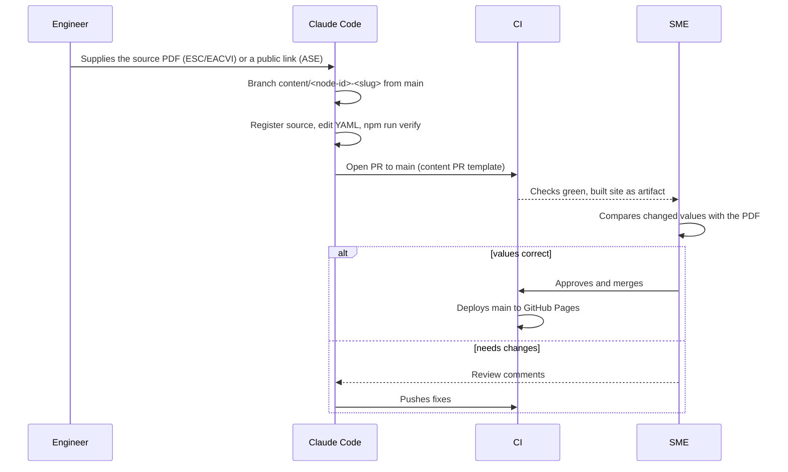

# Runbook: content update

> **Purpose:** change clinical content safely, from source document to live site.
> **Audience:** Claude Code sessions (drafting), SME (approval), engineer (supplying PDFs). **Last updated:** 2026-11-13
> **Rules:** [`CLAUDE.md`](../../CLAUDE.md) §3.2–3.3 and §12, [content guide](../content-guide.md), [content policy](../safety/content-policy.md).

## Which flow applies

| Situation | Flow |
|---|---|
| Initial seed of a subcategory that has no values yet (decision PO-3) | Direct push to `main`, topic `status: draft`, one subcategory per push |
| Any change to existing content (correction, new guideline, SME review result) | **Content pull request**, approved by the SME only |
| A published wrong value that must disappear now | [Emergency rollback](emergency-rollback.md), then a normal content PR with the correction |

## Content pull request

1. **Get the document.** Only a document actually read in the session is used. ESC/EACVI PDFs are supplied by a
   person (academic.oup.com blocks automated downloads); ASE documents are usually open access.
2. **Branch:** `git checkout main && git pull --ff-only && git checkout -b content/<node-id>-<short-slug>`
   (or `source/<source-id>` for a registry-only change).
3. **Source registry** (`content/sources/<id>.yaml`): add the document with metadata from its PubMed record.
   For a **new version of a guideline**: set the old source to `status: superseded` with `supersededBy: <new-id>`;
   never delete the old values (they move to "Previous recommendations" automatically).
4. **Values:** edit the topic's YAML blocks. Every value has a citation with a locator, a population with `ageGroup`,
   a `modality`, and the number and unit exactly as published. Check image tables and ≥/≤ signs on the rendered page.
5. **Check locally:** `npm run validate:content` (schema, registry, plausibility, discrepancies), then `npm run verify`.
6. **Commit and open the PR** with `main` as base. The body starts with the clinical change summary; the
   *Content summary* check posts the full value-by-value table (topic, parameter, population, society, old → new,
   locator) as a comment generated from the YAML diff and updates it on every push. Run it locally with
   `git worktree add /tmp/base main && npx tsx pipeline/summary/cli.ts /tmp/base .`. Keep the PR to one subcategory
   and data only.
7. **Review** (SME: [quick guide](../sme-quick-guide.md)): a PR idle for 7 days gets a reminder comment and one open for 14 days the `review-overdue` label
   (daily job, TS-06.3.3). CI must be green; the verification run (when available, TS-06.3.4) is advisory. **Only the SME approves
   and merges.** Claude Code never approves or merges a content PR.
8. **After merge:** CI deploys `main` (about 5 min). Check the live page: the value, the citation and the footer
   content version (short commit SHA). If the SME reviewed the whole topic, a follow-up content PR sets
   `status: published` and `lastReviewed: <date>`.
9. **Log:** the task plan push log records the PR when opened and when merged. The merge itself is recorded
   automatically in [`CHANGELOG.md`](../../CHANGELOG.md) (approvers, merger, time, sources, topics; TS-06.4.2); a
   row showing **none** under "Approved by" means a merge without approval and must be investigated.

## Errata and corrections

- **Publisher erratum** to a registered source: correct the affected values in a content PR; add the erratum DOI to the
  source's `notes`; the PR summary names the erratum.
- **Transcription error found by a user** ("Report a problem" link → issue labelled `content-issue`, or the e-mail fallback): reproduce against the PDF, then a content PR with the
  page and table in the summary. If the wrong value could change a clinical decision (hazard log severity S3), roll back
  first.
