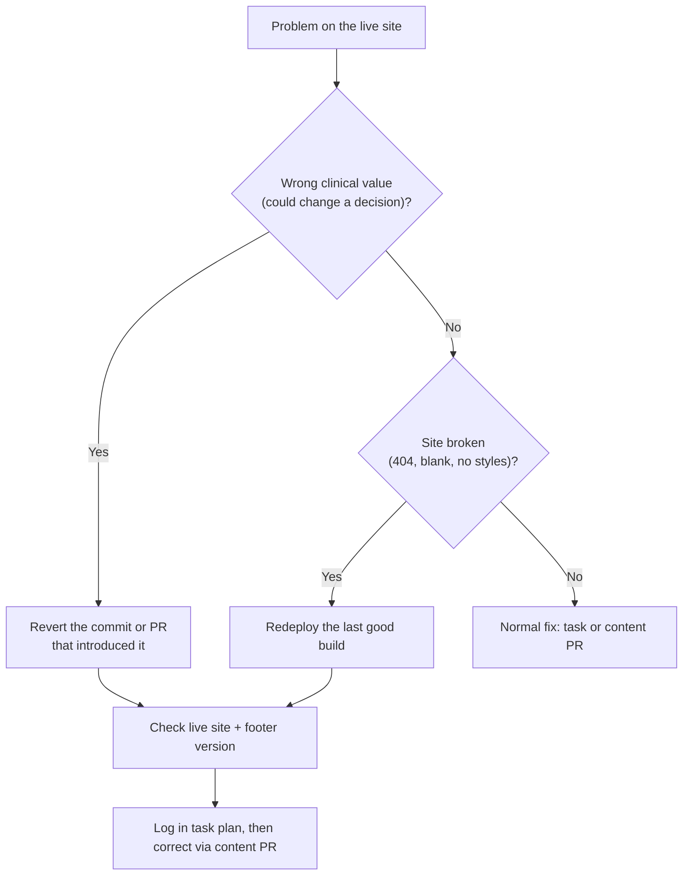

# Runbook: emergency rollback

> **Purpose:** take a wrong value or a broken build off the live site fast, then fix it properly (TS-08.6, TS-06.4.3).
> **Audience:** engineer (admin rights on the repository). **Last updated:** 2026-11-13
> **Rule:** a rollback only **removes** content or restores an earlier state; corrections always go through a normal
> content PR ([`CLAUDE.md`](../../CLAUDE.md) §3.2, emergency exception).

## Decide



## A. Revert a change (wrong value)

1. Find the commit: `git log --oneline -- content/` or the merged PR on GitHub.
2. **Merged content PR:** on the PR page click **Revert**; GitHub opens a revert PR. Merge it with the admin bypass
   (emergency exception); note the reason in the PR body.
3. **Direct commit on `main`** (seed content, code):

   ```bash
   git checkout main && git pull --ff-only origin main
   git revert <sha>        # one commit; for several: git revert <oldest>^..<newest>
   npm run verify
   git push origin main
   ```

4. CI verifies and deploys (about 5 min). Never force-push `main`.

## B. Redeploy the last good build (broken site)

1. *Actions → CI*: open the last run on `main` whose deploy succeeded and whose site was good.
2. *Re-run all jobs*. The run rebuilds that commit and deploys it.
3. This is a stopgap: the next push to `main` deploys again, so fix the cause (revert as in A, or a fix push) next.
4. A stale error page cached by the CDN (e.g. a 404 at the domain root after a domain change) is also cleared by a
   redeploy of the current run.

## C. Take the site offline (last resort)

*Settings → Pages → Unpublish site* (or switch the Pages source off). Use only if wrong content cannot be removed by A
or B quickly. Republish by re-running the latest good CI run.

## Check

- The page no longer shows the wrong value (load with a hard refresh; installed PWAs fetch pages network-first and get
  the new version on the next online visit).
- The footer **content version** matches the deployed commit.
- Search does not return the removed value (the search index is rebuilt with every deploy).

## Afterwards

1. Add a push log entry to [`docs/TASK_PLAN.md`](../TASK_PLAN.md) (a `CH-<n>` row if it was not planned work).
2. Open the correcting content PR (runbook: [content update](content-update.md)).
3. If the cause was a missing check, add a hazard or control to the [hazard log](../safety/hazard-log.md) and a test.
