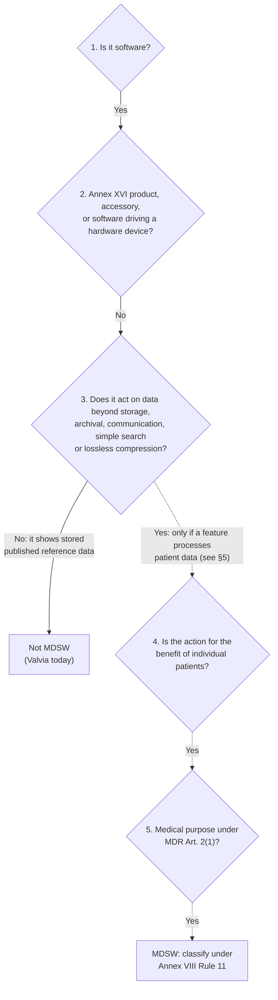

# EU MDR qualification memo

> **Purpose:** record why Valvia, as built, is not intended to qualify as medical device software (MDSW) under the EU MDR
> (Regulation (EU) 2017/745), and which changes would reopen that question (TS-07.1.1).
> **Audience:** product owner, engineer, SME, external reviewer. **Last updated:** 2026-11-13
> **Status:** engineering assessment, **not legal or regulatory advice**. It must be reviewed by a qualified regulatory
> adviser before go-live (TS-08.8). Check the reasoning against the **current revision** of MDCG 2019-11 and the MDR
> text; this memo summarises the guidance and does not quote it.
> **Related:** [About page](../../site/pages/about.astro) (intended use), [hazard log](hazard-log.md),
> [content policy](content-policy.md), [copyright assessment](copyright-assessment.md).

## 1. Product description

Valvia is a static website (installable as a PWA) that shows **published** echocardiography reference ranges and cut-off
values from ESC (including EACVI) and ASE documents. Each value is shown with its society, document, year and locator.

What it does:

- Lets a user browse a topic tree, search the pages and switch the displayed category (Adults, Children, TEE, Stress echo).
- Shows values in tables, lists and checklists in Valvia's own format, with units exactly as published.
- Shows disagreements between societies side by side, and superseded values as history.

What it **does not** do (by design, [`CLAUDE.md`](../../CLAUDE.md) §12 "No calculation", hazard H14):

- It accepts **no patient data**: there is no input field for a measurement, age, body size or any other patient value.
- It computes **nothing for a patient**: no calculators, no z-scores, no BSA, no risk scores, no grading of a measurement.
- It gives no diagnosis, prognosis, treatment recommendation or alert.
- It stores no data about users or patients (cookieless analytics only, no accounts in v1).

## 2. Intended purpose (as stated on the About page)

A quick-reference aid for echocardiographers, cardiologists, fellows and sonographers that displays reference ranges and
cut-off values exactly as published in ESC/EACVI and ASE documents, each with its source. It is stated to be **not a
medical device**; it does not calculate, interpret or classify measurements of individual patients, and clinical decisions
remain with the clinician. Users are told to verify every value against the original guideline.

The intended purpose is what the manufacturer states in labelling, instructions and promotional material. All of these
(site text, app-store or social-media descriptions, presentations) must stay consistent with the statement above.

## 3. Qualification reasoning (MDCG 2019-11 decision steps)

MDCG 2019-11 gives a stepwise decision aid for qualifying software. Summary of the steps as applied to Valvia:

| Step | Question (summarised) | Valvia | Reason |
|---|---|---|---|
| 1 | Is the product software? | Yes | A website and PWA |
| 2 | Is it an Annex XVI product, an accessory to a device, or software driving or influencing a hardware device? | No | Stand-alone; it does not connect to, control or receive data from an echo machine |
| 3 | Does it perform an action on data other than storage, archival, communication, simple search or lossless compression? | **No** | It stores published reference values and displays them; search finds pages by text and synonyms; the category switch only hides values of other categories. No patient data is ever entered or processed |
| 4 | Is the action for the benefit of individual patients? | Not reached (would be **No**) | The content is the same for every user and every patient; it is general medical knowledge, like a textbook, a printed guideline table or a digital library |
| 5 | Medical purpose under Art. 2(1)? | Not reached | |

**Conclusion (provisional):** with the current features, Valvia is a reference source of published medical knowledge and
does not meet the definition of MDSW. This depends on the features **and** on the stated intended purpose staying as described.

### Points an assessor may raise

| Point | Assessment |
|---|---|
| Grading tables (mild / moderate / severe cut-offs) look like diagnostic criteria | They reproduce published criteria as general knowledge; the user compares their own measurement mentally. Valvia never takes a measurement or returns a grade. Same as a printed guideline table |
| Paediatric z-score references | Shown only as published (dataset, equation or table, cited via the ESC/ASE document). No z-score is computed for a patient. Computing one would be an action on patient data for an individual patient (steps 3–4: **Yes**) |
| Disagreement and history logic | Runs at build time over the published values, not over patient data; it only decides how the reference content is displayed |
| Category switch (Adults / Children / TEE / Stress echo) | Filters the displayed reference content by category; it does not take patient characteristics |
| Search with synonyms | Simple text search over the site's own pages |
| Draft content, not yet clinically reviewed | A quality and safety issue (hazards H1, H10), not a qualification issue; it is labelled on every page |

## 4. Controls that keep the qualification

1. **Product rule:** no calculators, no patient inputs, no patient-specific output (`CLAUDE.md` §12, backlog: "no calculators in v1").
2. **Intended-use text** on the About page and in the footer disclaimer, reviewed whenever features change.
3. **Change gate:** any backlog item that adds an input field for patient data, a computation, an alert, or a
   recommendation for a specific patient must first update this memo (and the hazard log) and get the regulatory
   adviser's review **before** code is written.
4. **Promotion:** no claims such as "diagnoses", "grades your measurement" or "decision support" in any channel.

## 5. Changes that would reopen the question

| Possible feature | Likely effect |
|---|---|
| Entering a measurement and showing its grade, or highlighting the matching row | Action on patient data for an individual patient: likely MDSW |
| Computing z-scores, BSA-indexed values, valve areas or other derived values for a patient | Likely MDSW (calculation for diagnosis or monitoring) |
| Alerts or recommendations ("refer for surgery", "repeat echo in 6 months") for a patient | Likely MDSW |
| Integration with echo machines, PACS or reporting software | Step 2 / data processing: reassess |
| Accounts with favourites or notes (v2) | Not by itself qualifying if no patient data is stored; check GDPR separately |

If such a feature is ever wanted, MDR Annex VIII Rule 11 classification, a quality management system and conformity
assessment would apply; that is outside v1's scope and budget.

## 6. Actions

- [ ] Product owner: have this memo reviewed by a qualified regulatory adviser before go-live (TS-08.8); record the
      outcome in the [decision log](../decisions/README.md).
- [ ] If the reviewer considers any aspect unclear, consider asking the national competent authority (in Sweden,
      Läkemedelsverket) for its view before launch.
- [ ] Re-assess on every new feature that touches the points in §5, and at least once a year.
