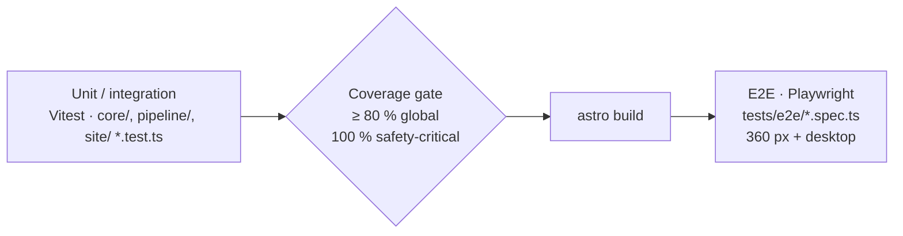

# Testing guide

> **Purpose:** how Valvia is tested, how to run the tests and what the gates are.
> **Audience:** engineer, Claude Code sessions. **Last updated:** 2026-11-02

Valvia is built test-first (TDD, `CLAUDE.md` §5). Every push runs the full local gate:

```bash
npm run verify   # format:check → lint → typecheck → test (coverage) → build → check:links --site → test:e2e
```

## Test layers



| Layer | Command | Location | Notes |
|---|---|---|---|
| Unit / integration | `npm test` (`npm run test:watch` while developing) | next to the code: `foo.ts` + `foo.test.ts` | Node environment, deterministic, no network |
| E2E | `npm run test:e2e` | `tests/e2e/` | Runs against `astro preview` of the production build at `/valvia/`; build first |
| Internal links | `npm run check:links` (add `-- --site` after a build) | `pipeline/links/` | Markdown relative links + heading anchors; built pages stay under the base path and resolve to built files/ids. External URLs are not checked (offline, deterministic) |
| Content validation | `npm run validate:content` (coming with EP-02) | `/content` | Schema, references, allowlist, plausibility |

## Coverage

Configured in [`vitest.config.ts`](../vitest.config.ts); `npm test` fails below the thresholds.

| Scope | Lines / branches / functions / statements |
|---|---|
| Global (`core/`, `pipeline/`, `site/` TypeScript) | ≥ 80 % |
| `core/units/**`, `core/sources/**`, `core/population/**`, `core/discrepancy/**`, `core/history/**` | 100 % |

Reports: terminal summary, `coverage/index.html`, `coverage/lcov.info`. Exclusions are listed in the config with a reason.

## Browsers

Playwright is pinned to the version whose Chromium is installed in the cloud environment (1.63.0).
On a local machine run `npx playwright install chromium` once.

## Writing tests

- Test behaviour through public functions; name tests as specifications.
- Table-driven tests (`it.each`) for conversions, schema rules and grading boundaries.
- Fixtures live in `__fixtures__/` folders next to the tests that use them.
- A bug fix starts with a failing test that reproduces it.
