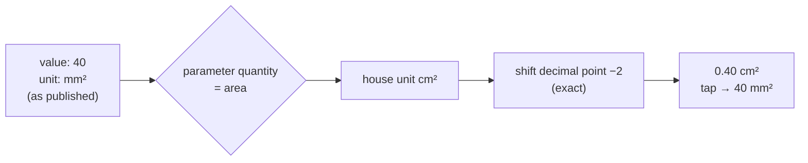

# Units and conversions

> **Purpose:** how values are stored, displayed and converted (NFR-15, taxonomy 14.2, TS-02.2.7).
> **Audience:** engineer, Claude Code sessions, SME. **Last updated:** 2026-11-02 | **Code:** [`core/units/units.ts`](../core/units/units.ts) (100 % coverage)

## Rules

1. **Store as published.** A value is stored with the number and unit printed in the source.
2. **Display in the house unit** of the parameter's quantity; when the quantity has no house unit yet (pending SME F4), display as published.
3. **Original on tap.** Converted values carry the published value and unit for the "original" popover.
4. **Exact conversion.** All supported conversions are powers of ten, done by moving the decimal point in the
   published digits, never with floating-point arithmetic. `40 mm²` → `0.40 cm²` keeps the published precision.

## Quantities

| Quantity | Allowed published units | Display (house) unit |
|---|---|---|
| `length` | mm, cm | **mm** (SME decision 8) |
| `area` | mm², cm² | **cm²** (SME decision 8) |
| `velocity-blood` | m/s, cm/s | **m/s** (SME decision 8) |
| `velocity-tissue` | cm/s, m/s | **cm/s** (SME F4 answered) |
| `volume` | mL | mL (proposed, F4) |
| `indexed-volume` | mL/m² | mL/m² (proposed, F4) |
| `mass` | g | g |
| `indexed-mass` | g/m², g/m^2.7 | as published (two different indexations, never converted into each other) |
| `indexed-length` | mm/m², cm/m² | as published (pending F4) |
| `indexed-area` | cm²/m² | cm²/m² |
| `pressure` | mmHg | mmHg (proposed, F4) |
| `time` | ms, s | ms (proposed, F4) |
| `percent` (strain, EF) | % | % (proposed, F4) |
| `ratio`, `dimensionless` | 1 | 1 |
| `acceleration`, `heart-rate`, `flow-rate`, `calcium-score`, `angle`, `age` | m/s², bpm, mL/s, AU, °, years | same |

## Content rules

- A parameter's `unit` must belong to its quantity and equal the house unit when one exists (`checkParameterUnit`).
- A value's published unit must belong to its parameter's quantity (enforced by the value rules, TS-02.2.4).
- BSA indexation uses the **DuBois** formula (display/explanation only; no patient calculation in v1).

## Changing units

Adding a unit or house unit is a code change (schema `unit` enum + `QUANTITY_UNITS`/`SCALES`) and needs tests for every new
conversion pair. Changing a house unit changes what clinicians see: record the SME decision first (`docs/decisions/`).
