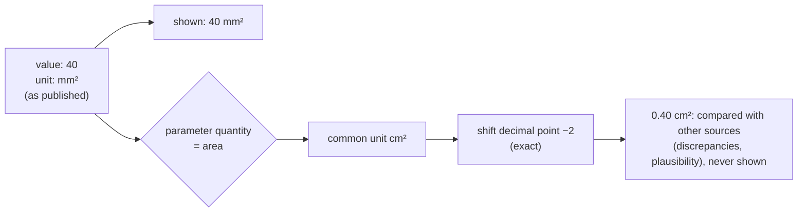

# Units

> **Purpose:** how values are stored, displayed and compared (decision PO-4, TS-02.2.7, CH-18).
> **Audience:** engineer, Claude Code sessions, SME. **Last updated:** 2026-11-13 | **Code:** [`core/units/units.ts`](../core/units/units.ts) (100 % coverage)

## Rules

1. **Store as published.** A value is stored with the number and unit printed in the source.
2. **Display as published (PO-4, 2026-11-09).** The site shows exactly that number and unit. There is no conversion to
   house units and no "original on tap": a vena contracta published as `0.7 cm` is shown as `≥ 0.7 cm`. When one parameter
   appears in two units in the same table (two sources), each unit gets its own row.
3. **Convert only to compare.** To decide whether values from different sources agree (discrepancies) or whether grades
   are monotonic (plausibility), values are converted to the parameter's **common unit**. These converted numbers are
   never displayed.
4. **Exact conversion.** All supported conversions are powers of ten, done by moving the decimal point in the published
   digits, never with floating-point arithmetic. `40 mm²` compares equal to `0.40 cm²`.

## Quantities

| Quantity | Allowed published units | Common (comparison) unit |
|---|---|---|
| `length` | mm, cm | mm |
| `area` | mm², cm² | cm² |
| `velocity-blood` | m/s, cm/s | m/s |
| `velocity-tissue` | cm/s, m/s | cm/s |
| `velocity-time-integral` | cm | cm |
| `volume` | mL | mL |
| `indexed-volume` | mL/m² | mL/m² |
| `mass` | g | g |
| `indexed-mass` | g/m², g/m^2.7 | none (two different indexations, never converted into each other) |
| `indexed-length` | mm/m², cm/m² | none (compared only within the same unit) |
| `indexed-area` | cm²/m² | cm²/m² |
| `pressure` | mmHg | mmHg |
| `time` | ms, s | ms |
| `percent` (strain, EF) | % | % |
| `ratio`, `dimensionless` | 1 | 1 |
| `acceleration` | m/s², cm/s² | m/s² |
| `heart-rate`, `flow-rate`, `calcium-score`, `angle`, `age` | bpm, mL/s, AU, °, years | same |
| `coupling-ratio` (e.g. TAPSE/PASP) | mm/mmHg | mm/mmHg |
| `vascular-resistance` | WU (Wood units) | WU |
| `mass-per-height` (LV mass/height) | g/m | g/m |
| `indexed-flow-rate` (e.g. neonatal ventricular output) | mL/min/kg | mL/min/kg |

## Content rules

- A parameter's `unit` must belong to its quantity and equal the common unit when one exists (`checkParameterUnit`).
- A value's published unit must belong to its parameter's quantity (enforced by the value rules, TS-02.2.4).
- BSA indexation uses the **DuBois** formula (explanation only; no patient calculation in v1).

## Changing units

Adding a unit is a code change (schema `unit` enum + `QUANTITY_UNITS`/`SCALES`) and needs tests for every new
conversion pair. The common unit only affects comparisons; what clinicians see is always the published unit.
